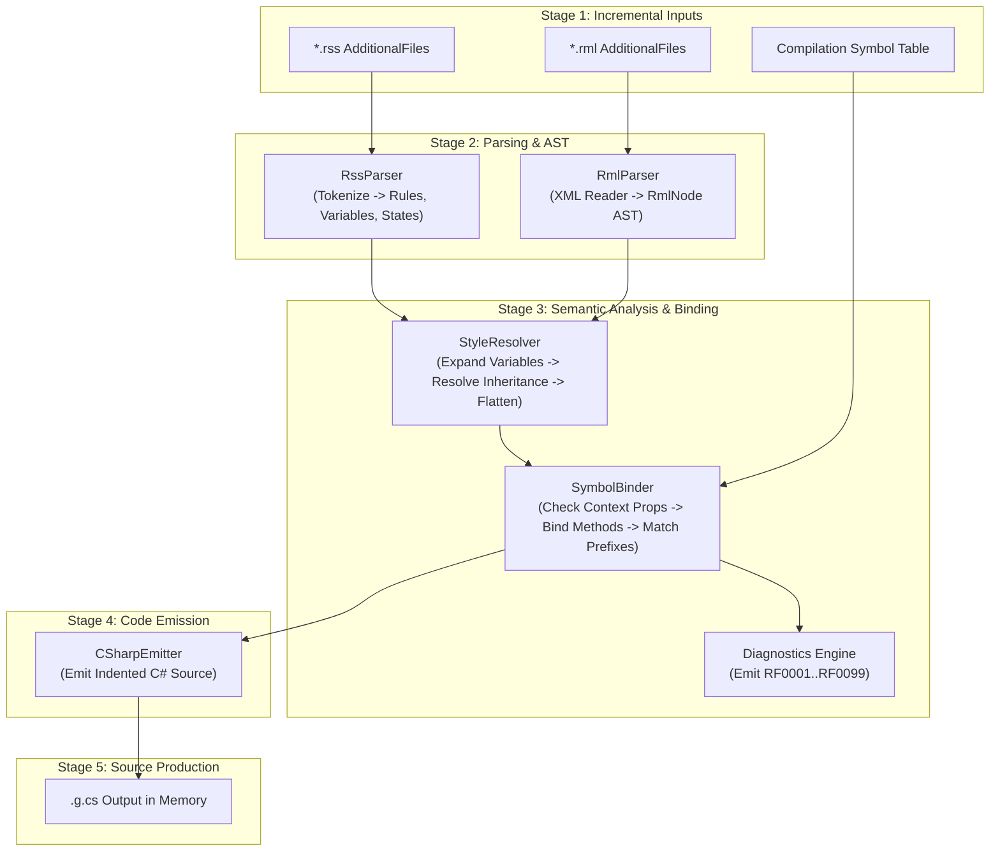

# Reef Markup Implementation Blueprint

One subject: the technical implementation architecture for the `Reef.Generator`
Roslyn incremental source generator. This document details the compilation
pipeline, AST models, semantic analysis, diagnostics, code emission, and build
integration for [specs/reef-markup](reef-markup.md).

## Project structure

The generator lives in `Reef.Generator/` alongside other engine generators
such as `Swordfish.ECS.Generator/`.

```text
Reef.Generator/
  Reef.Generator.csproj
  ReefGenerator.cs                      # IIncrementalGenerator implementation
  Parsing/
    RssLexer.cs                         # Tokenizer for .rss stylesheets
    RssParser.cs                        # AST builder for .rss rulesets
    RmlParser.cs                        # XML to RmlDocument AST parser
  Model/
    RmlDocument.cs                      # Document root (Class, Context, Namespaces)
    RmlNode.cs                          # AST base node
    ElementNode.cs                      # <Element> layout and container node
    TextNode.cs                         # <Text>
    ImageNode.cs                        # <Image>
    ContentNode.cs                      # <Content> definition and call site
    IfNode.cs                           # <If>, <ElseIf>, <Else>
    ForEachNode.cs                      # <ForEach>
    RssRuleset.cs                       # Complete stylesheet representation
    StyleRule.cs                        # Single selector rule
    PseudoState.cs                      # :hover, :active, :focus states
  Analysis/
    StyleResolver.cs                    # Inheritance, variable expansion, cascading
    SymbolBinder.cs                     # Binds @context properties and method calls
    DiagnosticDescriptors.cs            # Diagnostic definitions (RF0001 - RF0099)
  Emission/
    CSharpEmitter.cs                    # Emits partial classes and Render scopes
  Schemas/
    reef.xsd                            # XML schema for IDE autocompletion
  build/
    Reef.Generator.props                # Auto-includes *.rml and *.rss as AdditionalFiles
```

## Compilation pipeline

`ReefGenerator` implements `Microsoft.CodeAnalysis.IIncrementalGenerator`. It
executes in five discrete stages with aggressive memoization to preserve fast
build times.



### Stage 1: File discovery and project references

Consumer projects reference `Reef.Generator` as an analyzer without adding
runtime DLL dependencies:

```xml
<ItemGroup>
  <ProjectReference Include="..\Reef.Generator\Reef.Generator.csproj"
                    OutputItemType="Analyzer"
                    ReferenceOutputAssembly="false" />
</ItemGroup>
```

`Reef.Generator.props` auto-registers all `.rml` and `.rss` files as Roslyn
`AdditionalFiles`:

```xml
<Project>
  <ItemGroup>
    <CompilerVisibleItemMetadata Include="AdditionalFiles" MetadataName="SourceItemGroup" />
    <AdditionalFiles Include="**/*.rml" />
    <AdditionalFiles Include="**/*.rss" />
  </ItemGroup>
</Project>
```

In `ReefGenerator.Initialize(IncrementalGeneratorInitializationContext context)`:

```csharp
IncrementalValuesProvider<AdditionalText> rmlFiles = context.AdditionalTextsProvider
    .Where(static file => file.Path.EndsWith(".rml", StringComparison.OrdinalIgnoreCase));

IncrementalValuesProvider<AdditionalText> rssFiles = context.AdditionalTextsProvider
    .Where(static file => file.Path.EndsWith(".rss", StringComparison.OrdinalIgnoreCase));
```

To ensure optimal Roslyn incremental caching, Stage 1 projects each `AdditionalText`
into an immutable model `AdditionalFileItem(string Path, string ContentText, int ContentHash)`.
The pipeline attaches an equality comparer on this item, ensuring that parsing
(Stage 2), analysis (Stage 3), and emission (Stage 5) execute only when markup or
style file contents actually change. This guarantees sub-millisecond build times
and zero overhead when editing unrelated `.cs` code.

The generator contains zero native dependencies and does not invoke external
font atlas binaries like `msdf-atlas-gen.exe`. It runs cross-platform on Linux,
macOS, and Windows in both CI and local developer environments.

### Stage 2: Parsing

#### RSS parser

`RssLexer` tokenizes `.rss` text into tokens (`Identifier`, `Dot`, `Colon`,
`BraceOpen`, `BraceClose`, `Semicolon`, `Variable`, `String`, `Number`).
Standard CSS block comments `/* ... */` are recognized and skipped during
lexing. Syntax errors during active editing are caught gracefully and reported
as diagnostic `RF0002` without crashing the generator.

`RssParser` transforms tokens into an `RssRuleset`:
1. `:root { --var: value; }` definitions become entries in a variable table.
2. Selectors are parsed. Subclass syntax `.sub : .base` sets `ParentSelector`.
3. Pseudo-classes (`:hover`, `:active`, `:focus`) attach to the current rule as
   conditional property overrides.

#### RML parser

`RmlParser` reads `.rml` text using `System.Xml.XmlReader` for speed and low
allocation. Standard XML comments (`XmlNodeType.Comment`) are ignored during
reading. Malformed XML during active typing is caught and emitted as diagnostic
`RF0001` with exact line and column numbers, preventing generator crashes:
1. Root `<Reef>` attributes are read (`Class`, `Context`, `Namespace`, XMLNS prefixes).
2. Child elements map to AST nodes:
   - `<Element>` $\rightarrow$ `ElementNode`.
   - `<Text>` $\rightarrow$ `TextNode`.
   - `<Image>` $\rightarrow$ `ImageNode`.
   - `<If>`, `<ElseIf>`, `<Else>` $\rightarrow$ `IfNode`.
   - `<ForEach>` (with optional `<Empty>`) $\rightarrow$ `ForEachNode`.
   - `<Content>` $\rightarrow$ `ContentNode`.
   - Custom tags (`<prefix:Widget>`) $\rightarrow$ `CustomWidgetNode`.
3. Attributes parse into strongly-typed values (`ConstraintValue`, `PaddingValue`,
   `ColorValue`, `CornerRadiusValue`, `BindingExpression`). String attributes
   support literal brace escapes via `{{` and `}}`. Dynamic class directives
   (`class:<name>="@condition"`) parse into conditional style attachments.
   Expression parsing converts single-quoted argument strings (`'...'`) to
   double-quoted C# strings, and normalizes operator aliases (`lt`, `gt`, `lte`,
   `gte`, `eq`, `ne`).

### Stage 3: Semantic analysis and style resolution

`StyleResolver` processes all stylesheets into an aggregated dictionary:

1. **Variable expansion**: Any `var(--name)` value replaces with its resolved
   `:root` value. Circular variables raise diagnostic `RF0002`.
2. **Inheritance flattening**: For each rule `.sub : .base`, properties from
   `.base` copy into `.sub` unless `.sub` explicitly overrides them. Circular
   inheritance raises diagnostic `RF0003`.
3. **Element style matching**: When an AST node specifies `class="btn btn-primary"`:
   - Rules are merged in order of appearance (left-to-right precedence).
   - Dynamic class directives (`class:name`) attach conditional property branches.
   - Any inline attributes on the tag override stylesheet values.
   - Interactive pseudo-states (`:hover`, `:active`, `:focus`, `:disabled`)
     extract into separate property sets for emission.

`SymbolBinder` runs semantic checks against the active compilation:

1. Validates that `Context` resolves to a known type in the compilation symbols.
2. For expressions like `@context.PlayerName`, verifies that `PlayerName` exists
   on the context type.
3. For expressions referencing `@ui.`, verifies standard `UIBuilder` properties
   (`Time`, `Delta`, `Width`, `Height`).
4. For custom tags with XML namespace prefixes (`<wb:TextButton>`), verifies that
   the namespace exists and contains matching method symbols.
5. Collects referenced helper and callback methods (e.g. `@Localize(...)`,
   `@GetKeyBinding(...)`, `OnKick(member.Id)`). Derives argument types from
   expression symbols to emit exact companion `partial` method signatures.
6. Derives namespaces when the `Namespace` attribute is omitted by querying
   `build_property.RootNamespace` and `build_property.ProjectDir` from Roslyn
   `AnalyzerConfigOptionsProvider.GlobalOptions`. If `RootNamespace` is not
   defined, it falls back to the compilation assembly name, appending subfolder
   segments matching the `.rml` file path.
7. Resolves tag elements using strict priority:
   - Built-in Reef tags (`Element`, `Text`, `Image`, `If`, `ElseIf`, `Else`, `ForEach`, `Empty`, `Content`).
   - Local `.rml` components whose `<Reef Class="...">` matches the tag name (e.g. `Button`, `Vertical`, `Horizontal`, `Stack`, or custom views).
   - External C# widget methods matching the tag name in imported namespaces (`xmlns:<prefix>`).
   - If none match, emits diagnostic `RF0015`.

### Stage 4: Diagnostics engine

The generator emits standard Roslyn diagnostics. These appear in IDE error
lists and fail the build on severe issues:

| ID | Severity | Description |
|---|---|---|
| `RF0001` | Error | XML syntax error or unclosed tag in `.rml`. |
| `RF0002` | Error | Undefined or circular CSS variable reference in `.rss`. |
| `RF0003` | Error | Circular class inheritance in `.rss` rules. |
| `RF0004` | Error | Unresolved context property in binding expression. |
| `RF0005` | Error | Invalid constraint attribute format. |
| `RF0006` | Warning | Unused named content slot in component call site. |
| `RF0007` | Error | Unresolved XML namespace prefix. |
| `RF0008` | Error | Multiple `<Else>` or misordered `<ElseIf>` tags. |
| `RF0009` | Error | Misplaced or duplicate `<Empty>` tag (declared outside `<ForEach>` or multiple). |
| `RF0010` | Error | Interactive element inside `<ForEach>` missing explicit key-bound `id`. |
| `RF0011` | Error | Invalid `bind` expression (target is read-only, missing, or non-lvalue). |
| `RF0012` | Error | Duplicate style variable across `.rss` files without `override`. |
| `RF0013` | Error | Conflicting `override` declarations for style variable. |
| `RF0014` | Error | Void or value-returning custom widget cannot contain child elements. |
| `RF0015` | Error | Unknown element or component `<TagName>`. |
| `RF0016` | Error | Invalid color value. |
| `RF0017` | Error | Invalid dimension value. |
| `RF0018` | Error | Invalid shorthand value. |
| `RF0019` | Error | Unknown or invalid attribute. |
| `RF0020` | Error | Invalid expression. |
| `RF0021` | Error | Type mismatch. |
| `RF0022` | Error | Unknown style property. |
| `RF0023` | Error | Invalid enum value. |
| `RF0024` | Warning | Duplicate element ID. |
| `RF0025` | Error | Circular component reference. |
| `RF0026` | Error | Missing required attribute. |
| `RF0027` | Error | Invalid class directive. |
| `RF0028` | Error | Invalid root, type, namespace, or identifier. |
| `RF0029` | Error | Duplicate component class. |
| `RF0030` | Error | Component slot or context mismatch. |
| `RF0031` | Error | Unsupported construct. |
| `RF0032` | Warning | Unknown style class. |
| `RF0033` | Warning | Scroll configuration warning. |
| `RF0099` | Error | Internal generator error. |

### Stage 5: Code emission (`CSharpEmitter`)

`CSharpEmitter` writes procedural, allocation-free C# into a `StringBuilder`:

1. **Header**: Auto-generated comment, `#nullable enable`, and `using`
   directives (`Reef`, `Reef.UI`, `Reef.Constraints`, `System.Numerics`).
2. **Type declaration**: `<access> partial class <ClassName>` matching the `Class`
   and `Access` attributes (`public` or `internal`, defaulting to `public` or
   inheriting accessibility from an existing companion partial class).
3. **Partial method signatures**:
   - Callbacks referenced without `@context.` (e.g. `partial void OnPlay();`).
   - Non-void helper methods emitted as `protected partial` to enforce
     implementation in code-behind under C# rules (e.g. `protected partial string Localize(string key);`).
   - Dynamic key methods (e.g. `protected partial Reef.UIController.Key GetKeyBinding(string action);`).
4. **Render method and component styling**:
   - When `RendererData` is defined on `<Reef>`, generates concrete signature
     `public void Render(UIBuilder<ConcreteType> ui, <ContextType> context, StyleOverride? callerStyle = null, ConstraintsOverride? callerConstraints = null, string? idPrefix = null)`.
   - When omitted, generates generic signature
     `public void Render<TData>(UIBuilder<TData> ui, <ContextType> context, StyleOverride? callerStyle = null, ConstraintsOverride? callerConstraints = null, string? idPrefix = null)`.
   - The root element automatically merges caller styles and constraints with
     its internal styles. View methods and event callbacks invoke companion
     partial methods directly on `this`.
5. **Slot inlining and zero-allocation projection**:
   - When a component call site uses `<Content>` and both components exist in
     the same compilation, the generator inlines the slot AST directly into
     the parent scope. This avoids per-tick `Action<T>` delegate heap allocations.
   - For standalone or cross-module components, slot parameters fall back to
     delegates.
6. **Linear scope emission**:
   - Recursively emits `using (ui.Element(...))` and `using (ui.Text(...))` scopes.
   - For interactive elements (any `<Element>` declaring click, held, or scroll handlers)
     omitting an explicit `id` outside `<ForEach>` loops, the generator derives a
     deterministic identifier: `$"__rml_{fileKey}_{line}_{column}"`. This guarantees
     unique, stable immediate-mode interaction tracking without runtime hashing.
   - Emits `ui.LayoutDirection = LayoutDirection.<Value>` only when `layout="..."`
     is specified on `<Element>`, allowing the underlying Reef element to
     determine its own default when omitted.
   - For external custom C# widgets (`<prefix:Widget>`) declaring styles or
     constraints without a `Style` parameter, wraps the call in an outer
     styling `using (ui.Element())` scope.
   - Sizing and padding assignments use pre-calculated constants, including
     `MinWidth`, `MinHeight`, `MaxWidth`, and `MaxHeight`.
   - Emits `ui.Overlay = true;` when the element escapes parent clipping.
   - Emits `ui.HorizontalAlignment`, `ui.VerticalAlignment`, and `NoWrap` for
     text elements.
   - Emits ternary expressions for active pseudo-states (`hovering ? ... : ...`).
   - Emits C# `if`/`else` for `<If>` blocks, `foreach` for `<ForEach>` blocks,
     and change detection with writebacks for `bind` expressions.

## XML Schema (`reef.xsd`)

To provide instant autocompletion, documentation, and syntax validation in
editors like JetBrains Rider, Visual Studio, and VS Code, `Reef.Generator`
bundles `reef.xsd`:

```xml
<?xml version="1.0" encoding="utf-8"?>
<xs:schema xmlns:xs="http://www.w3.org/2001/XMLSchema"
           targetNamespace="Reef"
           xmlns="Reef"
           elementFormDefault="qualified">

  <xs:element name="Reef">
    <xs:complexType>
      <xs:choice minOccurs="0" maxOccurs="unbounded">
        <xs:group ref="UIElements" />
      </xs:choice>
      <xs:attribute name="Class" type="xs:string" use="required" />
      <xs:attribute name="Access" type="xs:string" use="optional" />
      <xs:attribute name="Context" type="xs:string" use="optional" />
      <xs:attribute name="RendererData" type="xs:string" use="optional" />
      <xs:attribute name="Namespace" type="xs:string" use="optional" />
    </xs:complexType>
  </xs:element>

  <xs:group name="UIElements">
    <xs:choice>
      <xs:element name="Element" type="ElementType" />
      <xs:element name="Text" type="TextType" />
      <xs:element name="Image" type="ImageType" />
      <xs:element name="If" type="IfType" />
      <xs:element name="ElseIf" type="IfType" />
      <xs:element name="Else" type="ElseType" />
      <xs:element name="ForEach" type="ForEachType" />
      <xs:element name="Content" type="ContentType" />
    </xs:choice>
  </xs:group>

  <xs:complexType name="ForEachType">
    <xs:choice minOccurs="0" maxOccurs="unbounded">
      <xs:group ref="UIElements" />
      <xs:element name="Empty" type="ElementType" minOccurs="0" maxOccurs="1" />
    </xs:choice>
    <xs:attribute name="in" type="xs:string" use="required" />
    <xs:attribute name="as" type="xs:string" use="required" />
    <xs:attribute name="index" type="xs:string" use="optional" />
  </xs:complexType>
  ...
</xs:schema>
```

Consumer projects reference `reef.xsd` at the top of their `.rml` files via
`xmlns="Reef"`.

## Implemented deviations and additions

The implementation keeps the pipeline in this blueprint. These decisions
change the first draft:

- Use `bind` for two-way binding. XML 1.0 does not allow `@bind`.
- Dynamic class directives require `xmlns:class="Reef.Class"`.
- Caller style and constraints use `StyleOverride` and `ConstraintsOverride`.
  Both types use nullable fields.
- Cross-assembly components use `ReefComponentAttribute`, slot delegates, and
  an `idPrefix` parameter.
- `Reef.Markup.TestComponents` supplies compiled components and widgets for
  cross-assembly tests.
- `Reef.Markup.Tests` compiles real fixtures and runs the visual gallery.
- The XML schema lives in `Reef.Generator/Schemas/reef.xsd`.
- Extra diagnostics cover invalid colors, dimensions, shorthands, attributes,
  expressions, types, enums, IDs, components, slots, and unsupported constructs.

## Implementation roadmap

The project implements in five sequential phases:

### Phase 1: Core AST and RML parser
- Create `Reef.Generator/` targeting `netstandard2.0`.
- Implement `RmlParser` using `XmlReader` to build AST for `<Reef>`, `<Element>`,
  `<Text>`, and `<Image>`.
- Implement basic `CSharpEmitter` generating layout constraints and scopes.
- Add unit tests in `Reef.Generator.Tests/` targeting `net8.0` using Roslyn
  `CSharpGeneratorDriver` to verify emitted source and diagnostic codes in
  memory without native runtime or font atlas dependencies. Once created,
  `dotnet test Reef.Generator.Tests` will be an engine quality gate running
  cross-platform on Linux in CI.
- Add `Reef.Markup.Tests/` for compiled fixtures, interaction, components, and
  the `PixelRenderer` golden-image gallery. Add `Reef.Markup.TestComponents/`
  for cross-assembly component and widget fixtures.

### Phase 2: Stylesheets (`.rss`) and state branching
- Implement `RssLexer` and `RssParser`.
- Add support for `:root` variables, style rules, and `.sub : .base` inheritance.
- Implement `StyleResolver` to flatten rules and compile `:hover`, `:active`,
  and `:focus` pseudo-states into ternary assignments.

### Phase 3: Control flow and data binding
- Add AST nodes and emission for `<If>`, `<ElseIf>`, `<Else>`, and `<ForEach>`.
- Implement expression parser for `@context.Prop`, string interpolation, and
  method bindings (`@Localize(...)`, `@GetKeyBinding(...)`).
- Emit companion partial method declarations.

### Phase 4: Component slots and custom widgets
- Implement `<Content [name="..."]>` declaration and projection.
- Implement XML namespace prefix parsing (`xmlns:prefix="..."`).
- Add symbol resolution for external extension widgets and custom components.

### Phase 5: Editor tooling and diagnostics
- Author `reef.xsd` schema and package it with the generator.
- Implement diagnostics (`RF0001` - `RF0099`).
- Wire `Reef.Generator` into `WaywardBeyond.Client` and verify build performance.

## Developer workflow and Hot Reload

Reef markup integrates with modern .NET development workflows:

1. **IDE Design-Time Experience**:
   - `reef.xsd` provides instant autocomplete and schema validation in Visual
     Studio, JetBrains Rider, and VS Code.
   - The incremental generator runs on file save, updating Roslyn semantic
     models and providing compile-time errors in `.rml` and `.rss` files.

2. **Runtime Hot Reload (`dotnet watch`)**:
   - Saving an `.rml` or `.rss` file triggers the Roslyn incremental generator
     to re-emit the in-memory `*.g.cs` source.
   - .NET Hot Reload swaps the method body of `Render()`.
   - Because Reef re-renders immediate-mode UI every tick, the very next frame
     executes the updated layout without restarting the process.

## Source of truth

- Specification: [specs/reef-markup](reef-markup.md)
- User onboarding: [userdocs/reef](../../userdocs/reef/README.md)
- Implementation plan: [reef-markup-implementation-plan](reef-markup-implementation-plan.md)
- Reef UI engine internals: [specs/reef-ui](reef-ui.md)
- Generator entry: `Reef.Generator/ReefGenerator.cs`
- Existing generator reference: `Swordfish.ECS.Generator/EcsComponentApiGenerator.cs`
- Build conventions: [development](../development.md)
